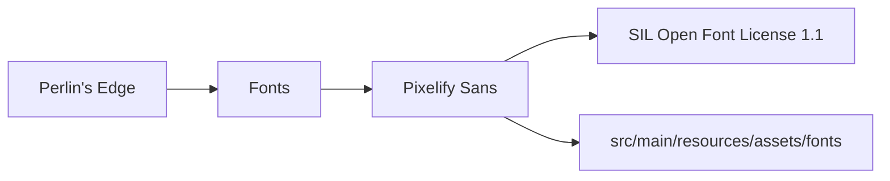

# Third-party assets and licenses

Every third-party asset bundled in the game, with its author, its license and where the license text lives next to the files.

## Fonts

| Asset | Author | License | Files |
|---|---|---|---|
| Pixelify Sans (variable weight) | The Pixelify Sans Project Authors | SIL Open Font License 1.1 | `src/main/resources/assets/fonts/PixelifySans.ttf`, license text in `src/main/resources/assets/fonts/OFL.txt` |

Source: https://github.com/google/fonts/tree/main/ofl/pixelifysans

The font is loaded once at startup by `UiTheme` and is the only font the GUI stylesheet (`src/main/resources/ui/theme.css`) uses. The OFL allows bundling and redistribution with the game as long as the license text travels with the font file and the font is not sold on its own.
