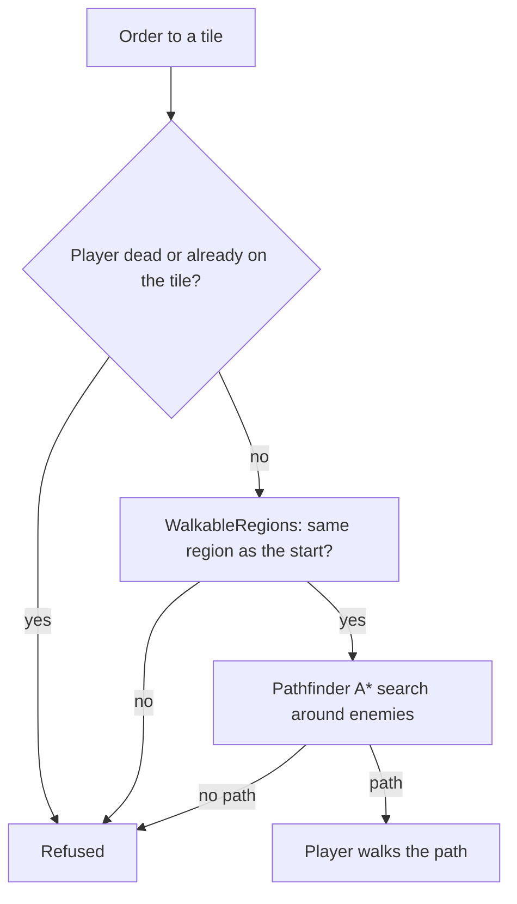
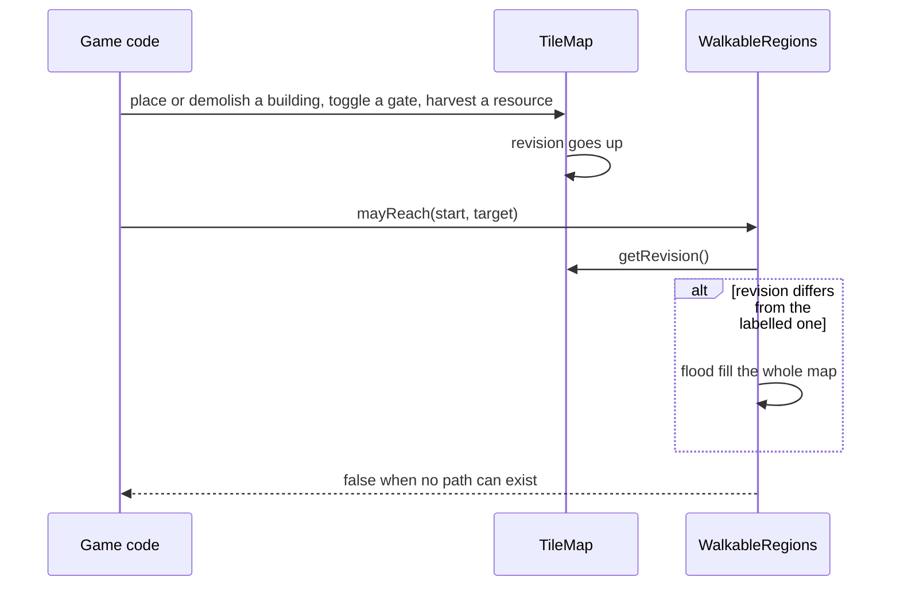

# Pathfinding

How the player and the enemies find their way across the map, and how an order to a tile nobody can reach is refused cheaply.

## Parts

- `Pathfinder` is an A* search over the tile grid with 8-directional movement. A diagonal step is only allowed when both tiles it passes between are walkable, so a path never cuts the corner of a blocked tile.
- `WalkableRegions` labels the walkable tiles of a map by region. It is owned by the `TileMap` and reached with `TileMap.getWalkableRegions()`.
- `Player.moveTo`, `InteractionPlanner.pathToReach` and the enemy `PathPlanner` ask the regions before they run a search.

## Move order flow

The region check is the difference between a refusal that costs one comparison and one that costs a search. A target in another region has no path whatever the search does, but A* only learns that after it has expanded every tile of the region the player stands in, which on a 300x300 map can be most of its 90000 tiles.

## Regions

A region is a maximal set of walkable tiles in which any tile can be walked to from any other. Tiles are joined through their four edges. That matches the search exactly: a diagonal step needs both tiles it passes between to be walkable, so the two tiles it joins are already joined through them.

Walkability is the one of `Tile.isWalkable()`:

- Water without a bridge, solid buildings (fences, a closed gate, stations) and standing resources (trees, rocks) block.
- A bridge or another floor makes a tile walkable, and an open gate, a harvested resource and a demolished building stop blocking.
- Enemies do not count. They move, and the tile an enemy holds is only taken for as long as it stays there, so the search still goes around enemies and may still fail. The regions only ever answer "no path exists".

A start tile that is not walkable, such as one that became solid under the walker, is never refused by the regions, because the search is allowed to leave such a tile.

## When the labels are rebuilt

Every change to what stands on a tile raises the map revision, and every query compares it with the revision the labels were built at. Many changes between two queries cost one relabelling, and a query on an unchanged map costs a comparison and an array read. A relabelling is a flood fill over two preallocated `int` arrays, with no allocation per tile, so its cost is linear in the number of tiles.

## Interactions

`InteractionPlanner.pathToReach` walks to a tile next to a target, which can be solid. The target is reachable when any of the eight tiles around it lies in the region of the start, so a tree on the player's own shore is reached and a tree on an island across the water is refused at once.

## Enemies

Enemies search with a cap on expanded tiles and back off after a failed search. A target in another region counts as a failed search without running the search, so the backoff is the same and the work is not spent.
