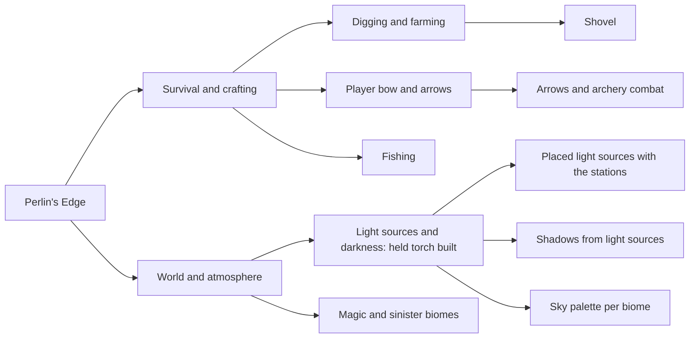

# Roadmap

Ideas for the game that are not built yet, grouped by what they add to it. Where a part of an idea is already built, its section says so and lists only what is left. Nothing here is promised or ordered, it is the shared list of where the game can grow.

## Digging and farming

A shovel to dig the ground and to prepare soil, with planting and harvesting crops on top of it. Digging is also the natural way to reshape the terrain and to place water or paths.

## Player bow and arrows

A bow and arrows the player crafts and fires at range, with ammunition that is spent and can be picked up again. It needs a projectile that the combat code can resolve against enemies, which the skeletons' ranged attack can share.

## Fishing

Rod, bait and a short catch mechanic at the water's edge, feeding the raw and cooked fish items that already exist.

## Light sources and darkness

The sun moves through dawn, day, dusk and night, casts shadows shaped like the things that stand in its light, and tints the world. The torch in the player's hand is a real light source: it pushes back the dark with stepped rings of warm, crackling light, exists only while a torch is the selected item, and does nothing at midday. A light is a source registered in the light registry, so any feature can add one without knowing how light is drawn. What is left of this idea:

- **Placed light sources**: standing torches, campfires and furnaces register a light when they are built and take it out when they are removed, and fire arrows and spells register short lived ones. They come with the stations and weapons that need them, as plain registrations of an existing light.
- **Shadows from light sources**: a light would also cast the shadows of what stands near it, away from itself, the way the sun does. This is postponed, since it needs a shadow cast per light and a rule for how those shadows fade with the distance.
- **Sky palette per biome**: the sky tint is the same for every biome today, so each biome can later get its own dawn, dusk and night palette.

## Magic and sinister biomes

Biomes with their own palettes, resources and creatures, such as an enchanted forest and a cursed swamp, kept separate from the realistic biomes so each map still reads as one place.
