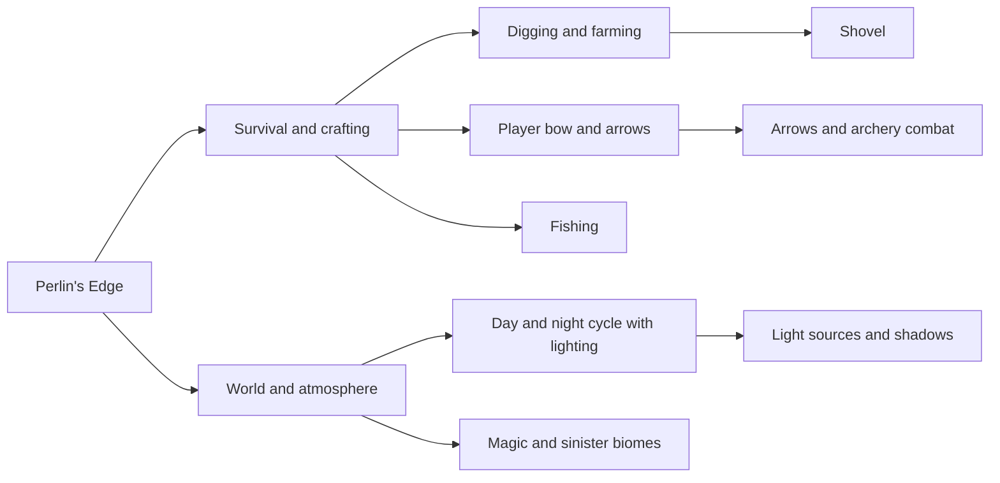

# Roadmap

Ideas for the game that are not built yet, grouped by what they add to it. Nothing here is promised or ordered, it is the shared list of where the game can grow.

## Digging and farming

A shovel to dig the ground and to prepare soil, with planting and harvesting crops on top of it. Digging is also the natural way to reshape the terrain and to place water or paths.

## Player bow and arrows

A bow and arrows the player crafts and fires at range, with ammunition that is spent and can be picked up again. It needs a projectile that the combat code can resolve against enemies, which the skeletons' ranged attack can share.

## Fishing

Rod, bait and a short catch mechanic at the water's edge, feeding the raw and cooked fish items that already exist.

## Day and night cycle with lighting

A clock that moves the world through dawn, day, dusk and night, with light that changes the palette of every biome. Torches, campfires and standing torches become real light sources at night, and shadows follow the sun.

## Magic and sinister biomes

Biomes with their own palettes, resources and creatures, such as an enchanted forest and a cursed swamp, kept separate from the realistic biomes so each map still reads as one place.
