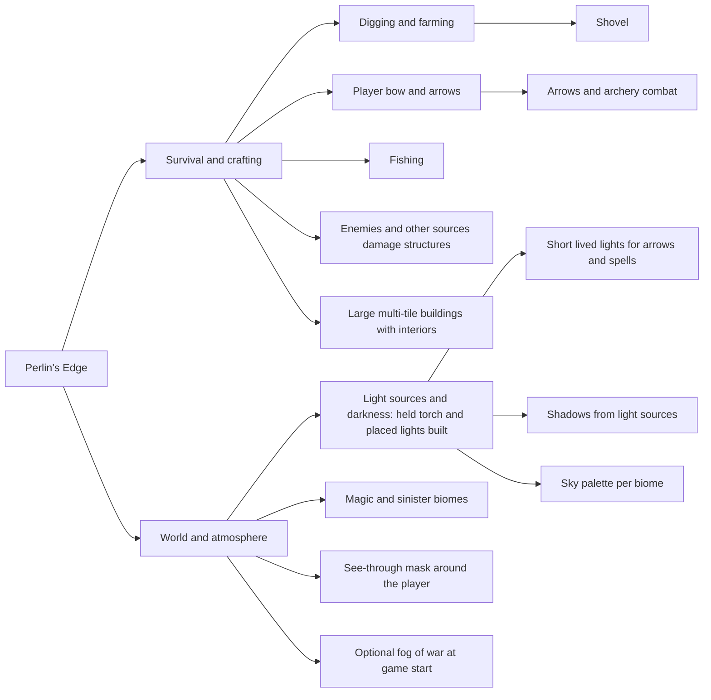

# Roadmap

Ideas for the game that are not built yet, grouped by what they add to it. Where a part of an idea is already built, its section says so and lists only what is left. Nothing here is promised or ordered, it is the shared list of where the game can grow.

## Digging and farming

A shovel to dig the ground and to prepare soil, with planting and harvesting crops on top of it. Digging is also the natural way to reshape the terrain and to place water or paths.

## Player bow and arrows

A bow and arrows the player crafts and fires at range, with ammunition that is spent and can be picked up again. It needs a projectile that the combat code can resolve against enemies, which the skeletons' ranged attack can share.

## Damage to structures

Every building already has health, a maximum per kind in `BuildingStats`, and a `damage` call that lowers it. Demolishing with the hammer already returns the share of the cost that matches the health left, and the hammer shows a health bar over a damaged building. What is missing is the damage itself: enemies that attack walls, doors and fences that block them, and other sources such as fire or explosions. It needs enemies that choose a structure as a target, a rule for what a destroyed structure leaves behind, and repair with the hammer so a damaged structure can be restored instead of only demolished.

## Large buildings with interiors

Buildings that span several tiles as one structure, such as a house or a windmill. The structure owns all the tiles it covers, so placing it needs a free footprint and demolishing it clears the whole footprint at once. Its door leads to a separate interior map that the player enters and leaves through that door, with its own tiles, light and furniture. It needs a multi-tile structure in the tile model, a way to switch the current map and come back to the same spot, and room-sized art for the exterior and the interior.

## Fishing

Rod, bait and a short catch mechanic at the water's edge, and the raw and cooked fish items it would bring.

## Light sources and darkness

The sun moves through dawn, day, dusk and night, casts shadows shaped like the things that stand in its light, and tints the world. The torch in the player's hand is a real light source: it turns the dark around the player into a warm wash that fades smoothly outward, drifts between orange and yellow and breathes at its edge, exists only while a torch is the selected item, and does nothing at midday. A light is a source registered in the light registry, so any feature can add one without knowing how light is drawn. What is left of this idea:

- **Short lived lights**: fire arrows and spells would register a light that lasts a moment. They come with the weapons that need them, as plain registrations of an existing light. Standing torches, campfires, furnaces and stone ovens already register a light when they are built and take it out when they are removed.
- **Shadows from light sources**: a light would also cast the shadows of what stands near it, away from itself, the way the sun does. This is postponed, since it needs a shadow cast per light and a rule for how those shadows fade with the distance.
- **Sky palette per biome**: the sky tint is the same for every biome today, so each biome can later get its own dawn, dusk and night palette.

## See-through mask around the player

When the player stands behind trees or other tall sprites, they are hidden by them. A circular, semi-transparent mask around the player would make the sprites that occlude them partly see-through, so the player shows through while the rest of the scene stays opaque. It needs a rule for which sprites count as occluding, such as those drawn in front of the player and overlapping them, a soft edge on the circle so the transition does not look cut, and a draw path that fades only those sprites instead of the whole layer.

## Fog of war

An option that starts a game with the whole map hidden, on the world and on the minimap, so the player explores to discover the land and the resources on it. Tiles the player has seen stay revealed and the rest stay dark, and with the option off the whole map is shown. It needs a record of which tiles were discovered, kept with the game state, a reveal radius around the player that grows as the player moves, a draw path that hides undiscovered tiles and the things standing on them, and a minimap that paints only what has been discovered.

## Magic and sinister biomes

Biomes with their own palettes, resources and creatures, such as an enchanted forest and a cursed swamp, kept separate from the realistic biomes so each map still reads as one place.
