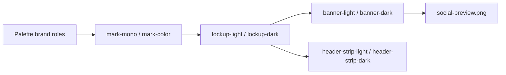

# Brand assets

The visual identity of Perlin's Edge: a pixel art tile whose far corner dissolves into noise, a warm cozy palette, and a small isometric landscape that grows out of that noise. Every SVG is hand-assembled from pixel rects with no external resources, no web fonts and no `<text>`, so each one renders identically on GitHub, in Markdown previews and in exported PDFs.

## Files

| File | Use |
|---|---|
| `mark-mono.svg` | The mark in one colour, drawn as an outline. Uses `currentColor`, so it inherits the text colour of whatever embeds it inline. |
| `mark-color.svg` | The mark in palette colours, transparent, meant for light backgrounds. |
| `lockup-light.svg` | Mark plus the wordmark in near-black violet, for light backgrounds. |
| `lockup-dark.svg` | Mark plus the wordmark in off-white, for dark backgrounds. The mark outline is off-white so it stays visible. |
| `banner-light.svg` | Full-width README banner, 1280x320, with the tagline. |
| `banner-dark.svg` | Dark variant of the banner. |
| `header-strip-light.svg` | Thin 1280x64 strip for the top of the deep docs, no tagline. |
| `header-strip-dark.svg` | Dark variant of the strip. |
| `social-preview.png` | 1280x640 repository social preview, the light banner composition. |

The banners and strips twinkle their noise pixels, shimmer the water and flicker the cabin window. All of that is plain CSS inside the SVG and is switched off by `@media (prefers-reduced-motion: reduce)`.

Embed the light and dark variants with a `<picture>` element so GitHub picks the right one for the reader's theme.

## Brand roles

Colours come from the game's own 40 colour pixel art palette. These are the roles used for docs, diagrams and badges.

| Role | Palette name | Hex |
|---|---|---|
| Primary | `water_1` | `#2a4f94` |
| Secondary | `sand_2` | `#dba867` |
| Accent | `crystal_2` | `#a96af0` |
| Success | `grass_2` | `#459b4c` |
| Warning | `fire` | `#ffa02a` |
| Neutral dark and outline | `outline` | `#1d1830` |
| Light surface and text on dark | `offwhite` | `#fcf4e4` |

## Font licence

The wordmark and the tagline are drawn with a hand-made 5x7 pixel font created for this project and stored as pixel rects. No third-party font or glyph outline is embedded or traced, so no font licence applies.
