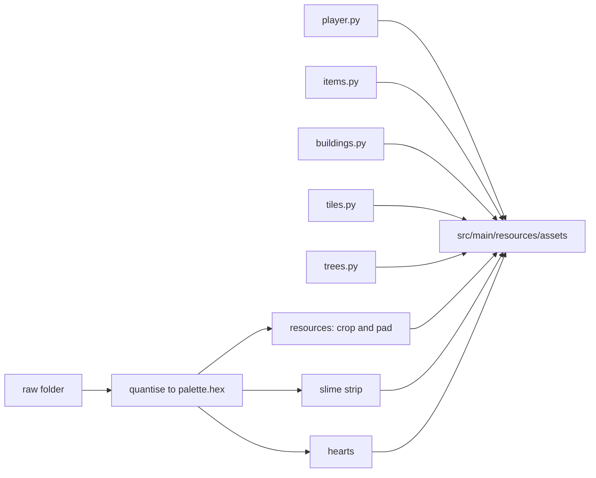
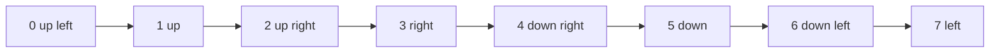

# Pixel art post-process

Turns the raw images generated for the game into the sprites it loads. The raw folder is local and not committed, the output lands in `src/main/resources/assets` and is committed.

## Usage

```bash
python -I tools/pixelart/build.py --raw <dir>
```

Requires Python 3.12 and Pillow. `--raw` is required and points at your local raw folder. `--out <dir>` changes the output folder, by default the game's `assets` folder. The tool is idempotent: it rebuilds every output it finds an input for, so run it again whenever raw files are added or replaced.



## Land tiles and decals

```bash
python -I tools/pixelart/tiles.py
```

`tiles.py` draws everything the ground is made of, with no raw input. Each land tile is a 32x21 block: a flat single colour top diamond with a one pixel darker edge on its two upper sides, which reads as a faint grid across the map, and a 5 pixel side face. It writes `assets/tiles/<name>-1.png` for grass, forest, savanna, hill, sand, dune, mountain, snow, ice and swamp, and the small decal sprites to `assets/decals/<name>.png`. Every tile is a column, and the game draws a face strip (`assets/faces/<name>.png`, the next 5 pixels of the side faces of that block) under a tile once per 5 pixels that a lower neighbour exposes. Water has no block of its own. Every water type is drawn over a sand bed with the same grid edge and side faces as land, sunk 10 pixels below the land tops per depth level: `assets/tiles/bed-1.png` for shallow, coast and river water (level 1) and `bed-deep-1.png` for deep water (level 2), so the banks and the step between the two depths show their side faces. Every pixel of a bed is mixed toward the water colour when it is baked, 45 percent for level 1 and 75 percent for level 2, so the grid and the decals on the bed fade with depth. The underwater decals (`under-seaweed-1`, `under-seaweed-2` and `under-pebble-1`) are baked in the same fog. One translucent sheet, `assets/water/sheet.png`, covers every water tile 5 pixels below the land tops, in the water colour at 30 percent opacity: a top diamond two pixels narrower than a land diamond, so neighbouring water tiles meet without overlapping and the sheet has no doubled seams. `lilypad-1` and `lilypad-2` are decals that float on the surface of some shallow tiles. `assets/water/shimmer-<n>.png` are three thin highlight lines that the game fades in and out over about two seconds, each tile on its own phase. `build.py` does not touch tiles, decals or water, so running it never overwrites them.

`--preview <file>` renders a patch of every tile with decals scattered on it instead of writing the assets.

## Resources drawn by script

```bash
python -I tools/pixelart/trees.py
```

`trees.py` draws the tree, bush, rock, iron ore, palm and cactus sprites with no raw input, into `assets/resources/<biome>/<kind>-<n>.png`. The default folder gets eight trees (five tiered pines and three round trees), three bushes, four rocks and three iron ore rocks with rust specks. The dense_forest folder gets six pines and the swamp folder four olive round trees. The desert folder gets four sandstone rocks, four palms and four cacti. The tundra folder gets four snow capped rocks and four snowy pines. Every variant of a kind gets its own small hue and lightness tint. A biome folder without a sprite of a kind uses the default folder, so only the biomes that look different need their own files. The game reads numbered variants of a kind until a number is missing, and each resource picks one from its tile coordinates and the world seed, so a tree keeps its look across frames and reloads. Adding a variant is one more entry in `SET` and needs no code change. `build.py` skips the `tree`, `bush`, `rock`, `iron`, `palm` and `cactus` kinds, so running it never overwrites them. Crystals and every other kind still come from the raw folder.

`--preview <file>` renders every sprite side by side instead of writing the assets.

## Item icons drawn by script

```bash
python -I tools/pixelart/items.py
```

`items.py` draws the icon of every `ItemType` with no raw input, 16x16 each, into `assets/items/<item>.png`. The file name is the lower case constant name, which is the name the game looks an icon up by. Every icon is built from a few shaded blobs, rectangles, lines and single pixels in colours of `palette.hex`, lit from the upper left and wrapped in the dark outline. The script has one drawing function per item and an `ICONS` table that maps the file name to it, so adding an item type is one function and one table entry. It writes every icon of the table and removes the stale icons of the folder, which are the files named like an item icon (lower case `ItemType` style names, such as `wood_log.png`) that no drawing produces. It prints each file it removes and never touches any other file, so a differently named image in the folder is safe. The game shows an icon at a whole multiple of its own size with image smoothing off, which keeps every art pixel a crisp block, and it only draws a stand-in shape for an item whose file is missing. `build.py` does not touch items, so running it never overwrites them.

`--preview <file>` renders every icon on a dark panel at 4x instead of writing the assets.

## Buildings drawn by script

```bash
python -I -B tools/pixelart/buildings.py
```

`buildings.py` draws every build mode piece with no raw input into `assets/buildings/<name>.png`. Each piece is a stack of boxes in tile space rendered by a small ray caster, so every orientation is the same object seen from another side and a back view shows the back. The colours are those of `palette.hex`, with the dark outline and light from the upper left. The run removes any other `.png` of the folder and prints each one.

| Files | Meaning |
|---|---|
| `chest_0..3`, `furnace_off_0..3`, `furnace_on_0..3`, `anvil_0..3`, `workbench_0..3`, `bed_0..3`, `dock_0..3` | 4 way pieces: the front faces the lower right edge (0), lower left (1), upper left (2), upper right (3), each step a quarter turn clockwise seen from above. The dock open end (posts) is its front |
| `bridge_0..1`, `fence_gate_closed_0..1`, `fence_gate_open_0..1` | 2 way pieces: axis 0 runs between the upper left and lower right edges, axis 1 between the upper right and lower left edges |
| `fence_post`, `fence_rail_ul`, `fence_rail_ur`, `fence_rail_ll`, `fence_rail_lr` | fence parts the game composes: a rail is half a rail from the post to the middle of that edge, drawn on the same anchor so the parts overlay exactly. Draw the back rails (ul, ur), the post, then the front rails (ll, lr). The gate posts and rails sit at the same heights, so a fence connects to a gate |
| `campfire_0..3`, `standing_torch_0..3` | animation frames, not rotated |

Every sprite is 32 px wide, all orientations of one piece share one height (20 to 40 px). The footprint is the 32x16 diamond of a land tile top and it always fills the bottom 16 rows of the canvas, so the bottom centre pixel of a sprite goes on the bottom vertex of the tile diamond and the tile centre is the pixel (16, height - 8). This differs from the resource sprites, whose canvas bottom sits on the tile centre: a building is drawn 8 art pixels lower than a tree of the same height.

`--preview <file>` renders every sprite at 3x on grass green and on water blue with labels, `--placed <file>` renders a map with a fence ring (a corner, a T and two gates composed from the parts), a 3 tile bridge and a dock, and `--orient <file>` renders every 4 way piece in its 4 orientations. None of them writes assets.

## Raw layout

| Raw input | Output |
|---|---|
| `resources/<biome>/<kind>-<n>.png`, any kind except tree, bush, rock, iron, palm and cactus | `assets/resources/<biome>/<kind>-<n>.png` |
| `gui/heart-full.png`, `heart-half.png` | `assets/gui/`, plus a derived `heart-empty.png` when no raw one exists |
| `entities/slime-<n>.png` | `assets/entities/slime-<n>.png`, a 6 frame strip |
| none, drawn by `player.py` | `assets/entities/player.png`, a 128x72 sheet |

The game picks up any variant number it finds, so adding `willow-2.png` or a second tile variant `grass-2.png` needs no code change.

## What the tool does

- Every image is snapped to the 40 colours in `palette.hex` by nearest RGB distance, with no dithering, and its alpha becomes binary.
- Resources are cropped to their content and centred on the bottom row of the canvas for their kind, for example 32x48 for a tree and 24x20 for a rock. Content larger than the canvas keeps its own size.
- Hearts are centred on 16x16.
- The slime strip has six frames of 20x16 made by squashing and stretching the single raw frame: rest, crouch, stretch, apex, fall, landing.
- The player sheet has 8 columns by 3 rows of 16x24 cells, drawn by `player.py` from rectangles with no raw input. The rows are walk a, idle and walk b.

## Player columns

The columns follow the game directions, starting at up left: up left, up, up right, right, down right, down, down left, left. The back views have no eyes, the left and right columns are profiles with a leg stride, and the walking rows bob the figure up by one pixel.


