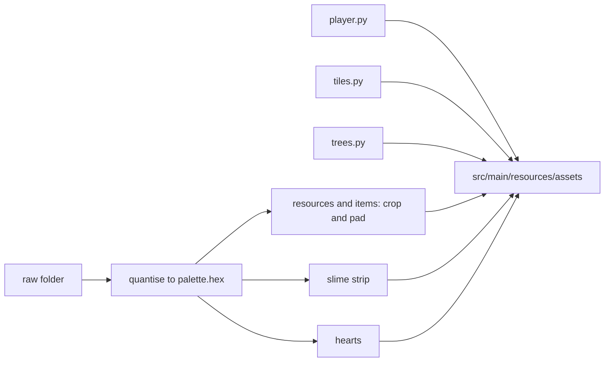
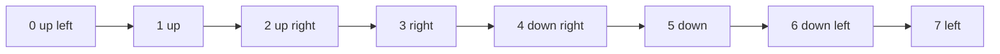

# Pixel art post-process

Turns the raw images generated for the game into the sprites it loads. The raw folder is local and not committed, the output lands in `src/main/resources/assets` and is committed.

## Usage

```bash
python -I tools/pixelart/build.py --raw <dir>
```

Requires Python 3.12 and Pillow. `--out <dir>` changes the output folder, by default the game's `assets` folder. The tool is idempotent: it rebuilds every output it finds an input for, so run it again whenever raw files are added or replaced.



## Land tiles and decals

```bash
python -I tools/pixelart/tiles.py
```

`tiles.py` draws everything the ground is made of, with no raw input. Each land tile is a 32x21 block: a flat single colour top diamond with a one pixel darker edge on its two upper sides, which reads as a faint grid across the map, and a 5 pixel side face. It writes `assets/tiles/<name>-1.png` for grass, forest, savanna, hill, sand, mountain, snow, ice and swamp, and the small decal sprites to `assets/decals/<name>.png`. Water has no tile of its own. Every water type is drawn as the sand tile sunk below the land level, then its seaweed or pebble decal, then a translucent water layer from `assets/water/<name>.png`: a 32x16 top diamond in light blue at 45 percent opacity for shallow, coast and river, and a darker blue at 75 percent for deep water. `assets/water/shimmer-<n>.png` are three thin highlight lines that the game fades in and out over about two seconds, each tile on its own phase. `build.py` does not touch tiles, decals or water, so running it never overwrites them.

`--preview <file>` renders a patch of every tile with decals scattered on it instead of writing the assets.

## Resources drawn by script

```bash
python -I tools/pixelart/trees.py
```

`trees.py` draws the tree, bush, rock and iron ore sprites with no raw input, into `assets/resources/<biome>/<kind>-<n>.png`. The default folder gets six trees (four tiered pines and two round trees), three bushes, four rocks and three iron ore rocks with rust specks. The dense_forest folder gets four pines and the swamp folder three olive round trees. A biome folder without a sprite of a kind uses the default folder, so only the biomes that look different need their own files. The game reads numbered variants of a kind until a number is missing, and each resource picks one from its tile coordinates and the world seed, so a tree keeps its look across frames and reloads. Adding a variant is one more entry in `SET` and needs no code change. `build.py` skips the `tree`, `bush`, `rock` and `iron` kinds, so running it never overwrites them. Crystals and every other kind still come from the raw folder.

`--preview <file>` renders every sprite side by side instead of writing the assets.

## Raw layout

| Raw input | Output |
|---|---|
| `resources/<biome>/<kind>-<n>.png`, any kind except tree, bush, rock and iron | `assets/resources/<biome>/<kind>-<n>.png` |
| `items/<item>.png` | `assets/items/<item>.png` |
| `gui/heart-full.png`, `heart-half.png` | `assets/gui/`, plus a derived `heart-empty.png` when no raw one exists |
| `entities/slime-<n>.png` | `assets/entities/slime-<n>.png`, a 6 frame strip |
| none, drawn by `player.py` | `assets/entities/player.png`, a 128x72 sheet |

Item files are named after the lower case `ItemType` constant. The game picks up any variant number it finds, so adding `willow-2.png` or a second tile variant `grass-2.png` needs no code change.

## What the tool does

- Every image is snapped to the 40 colours in `palette.hex` by nearest RGB distance, with no dithering, and its alpha becomes binary.
- Resources are cropped to their content and centred on the bottom row of the canvas for their kind, for example 32x48 for a tree and 24x20 for a rock. Content larger than the canvas keeps its own size.
- Items and hearts are centred on 16x16.
- The slime strip has six frames of 20x16 made by squashing and stretching the single raw frame: rest, crouch, stretch, apex, fall, landing.
- The player sheet has 8 columns by 3 rows of 16x24 cells, drawn by `player.py` from rectangles with no raw input. The rows are walk a, idle and walk b.

## Player columns

The columns follow the game directions, starting at up left: up left, up, up right, right, down right, down, down left, left. The back views have no eyes, the left and right columns are profiles with a leg stride, and the walking rows bob the figure up by one pixel.


