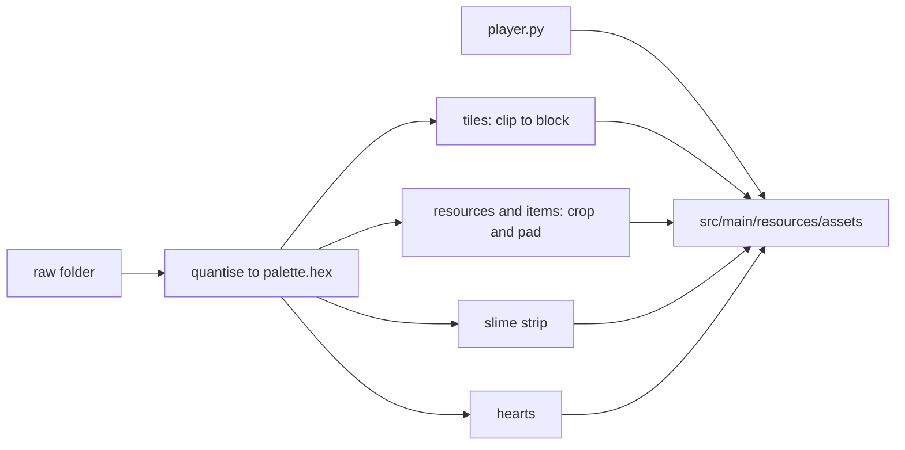
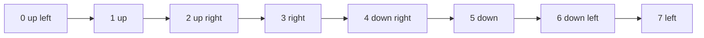

# Pixel art post-process

Turns the raw images generated for the game into the sprites it loads. The raw folder is local and not committed, the output lands in `src/main/resources/assets` and is committed.

## Usage

```bash
python -I tools/pixelart/build.py --raw <dir>
```

Requires Python 3.12 and Pillow. `--out <dir>` changes the output folder, by default the game's `assets` folder. The tool is idempotent: it rebuilds every output it finds an input for, so run it again whenever raw files are added or replaced.



## Raw layout

| Raw input | Output |
|---|---|
| `tiles/tile-<name>-<n>.png` | `assets/tiles/<name>-<n>.png` |
| `resources/<biome>/<kind>-<n>.png` | `assets/resources/<biome>/<kind>-<n>.png` |
| `items/<item>.png` | `assets/items/<item>.png` |
| `gui/heart-full.png`, `heart-half.png` | `assets/gui/`, plus a derived `heart-empty.png` when no raw one exists |
| `entities/slime-<n>.png` | `assets/entities/slime-<n>.png`, a 6 frame strip |
| none, drawn by `player.py` | `assets/entities/player.png`, a 128x72 sheet |

Item files are named after the lower case `ItemType` constant. The game picks up any variant number it finds, so adding `tile-grass-3.png` or `tree-4.png` needs no code change.

## What the tool does

- Every image is snapped to the 40 colours in `palette.hex` by nearest RGB distance, with no dithering, and its alpha becomes binary.
- Terrain is rebuilt as a 32x16 top diamond plus side faces, 5 pixels thick for land and 3 for water. The faces are re-cut from the bottom of the raw faces and everything outside the block silhouette is dropped, so grass tufts no longer poke out and neighbours tile exactly on the 2:1 grid.
- Resources are cropped to their content and centred on the bottom row of the canvas for their kind, for example 32x48 for a tree and 24x20 for a rock. Content larger than the canvas keeps its own size.
- Items and hearts are centred on 16x16.
- The slime strip has six frames of 20x16 made by squashing and stretching the single raw frame: rest, crouch, stretch, apex, fall, landing.
- The player sheet has 8 columns by 3 rows of 16x24 cells, drawn by `player.py` from rectangles with no raw input. The rows are walk a, idle and walk b.

## Player columns

The columns follow the game directions, starting at up left: up left, up, up right, right, down right, down, down left, left. The back views have no eyes, the left and right columns are profiles with a leg stride, and the walking rows bob the figure up by one pixel.


